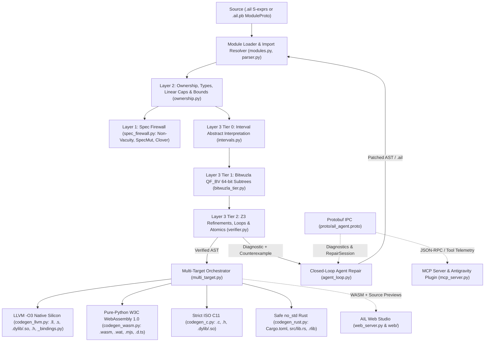

# AIL (`ailang` v1.0) — Architecture & Technical Specification

`ailang` (AIL) is an AI-native formally verified programming language, specification firewall, Protobuf agent protocol, and multi-target compiler (`LLVM` native silicon, pure-Python `WebAssembly 1.0`, ISO `C11`, and `#![no_std]` `#![forbid(unsafe_code)]` `Rust`).

AIL is designed around **AI agent economics** rather than human typing ergonomics:

- **Lossless 64-bit Wire Protocol (`proto/ail_agent.proto`)**: Compiler diagnostics, concrete counterexamples, `ModuleProto` binary ASTs, `RepairSession` traces, and benchmark telemetry exchange native `uint64` / `int64` varints instead of JSON numbers (avoiding IEEE-754 $2^{53}$ precision loss).
- **Stratified Formal Verification**: Every function is discharged bottom-up across microsecond Interval Abstract Interpretation (**Tier 0**), witness-sliced 64-bit `QF_BV` bit-vector proofs in **Bitwuzla** (**Tier 1**), and unbounded integer + inductive + concurrency proofs in **Z3** (**Tier 2**).
- **Pre-Codegen Spec Firewall (`SpecMut` & `Clover`)**: Rejects vacuous preconditions, kills weak postconditions via specification mutation testing before codegen, and extracts distinguishing counterexamples between ambiguous specifications.
- **Bit-Exact Multi-Target Lowering**: Verified ASTs compile cleanly to native LLVM `-O3` shared libraries/binaries, pure-Python binary WebAssembly 1.0 (`.wasm` + `.wat` + `.mjs` + `.d.ts`), strict `-Wall -Wextra -Werror` ISO C11, and `#![no_std]` `#![forbid(unsafe_code)]` Rust crates.

---

## End-to-End Compiler & Agent Pipeline

---

## Layer-by-Layer Technical Specification

### 1. Frontend, Binary AST & Module System (`parser.py`, `modules.py`, `stdlib/`)

1. **Spanned S-Expression Parser (`src/ailang/parser.py`)**:
   - Tokenizes `.ail` files with line/column `Span` tracking and `;` line comments.
   - Parses numeric refinement sugar `u64[lo..hi]` and `i64[lo..hi]` into internal `u64_range` / `i64_range` nodes.
   - Supports bare top-level declaration streams as well as optional `(module <name> <decl> ...)` wrappers.
   - Bidirectional lossless bridge (`snode_to_proto`, `module_to_proto`, `proto_to_snode`, `load_ail_path`) to binary `ModuleProto` (`.ail.pb`), eliminating syntax/delimiter token overhead for tool-calling agents.
2. **Imports & Constants (`src/ailang/modules.py`)**:
   - `load_ail_module_with_imports` resolves `(import "...")` declarations (such as `(import "stdlib/math")` and relative `.ail` paths), deduplicates diamond imports, detects import cycles (`E_IMPORT_CYCLE`), and substitutes `(const NAME u64|i64 <int_lit>)` definitions across subsequent declarations.
3. **Standard Library (`src/ailang/stdlib/`)**:
   - Verified built-in modules for arithmetic (`math.ail`), basis-point & quote math (`finance.ail`), bit-packing (`bits.ail`), and zero-copy big-endian header parsing (`parse.ail`), inspectable via `ail stdlib` and MCP `ail_stdlib_catalog`.

---

### 2. Layer 2: Ownership, Dependent Types & Linear Capabilities (`ownership.py`)

`check_module_ownership_v2` validates static types, memory ownership, and capability discipline prior to SMT solving:

- **Strict Numeric Separation**: Unsigned `u64` (`[0..MAX]`) and signed `i64` (`[MIN_I64..MAX_I64]`) cannot be implicitly mixed (`E_TYPE_MISMATCH`); conversions require explicit `(to_i64 x)` or `(to_u64 x)`. Unbounded `int` is permitted exclusively inside `(spec ...)` declarations.
- **Dependent Algebraic `struct`s**: Fields may reference earlier fields in their refinement bounds, e.g. `(ask u64[bid..1000000000])`.
- **Algebraic Sum Types (`enum` / `variant` / `is_variant` / `match`)**: Exhaustive pattern matching enforced statically (`E_NON_EXHAUSTIVE_MATCH`, `E_DUPLICATE_MATCH_ARM`), requiring identical linear capability consumption across every match arm.
- **Zero-Copy Memory & Exclusivity**:
  - `(slice len_var T)` — immutable length-indexed array slice.
  - `(mut_slice len_var T)` — linear non-aliasing mutable slice (`E_ALIASING_VIOLATION` rejects passing overlapping/duplicate mutable buffers).
  - `(bytes len_var)` — immutable length-indexed byte buffer supporting verified zero-copy big-endian readers (`byte_at`, `read_u16_be`, `read_u32_be`, `read_u64_be`, `bytes_eq4`).
- **Linear Capability Tokens (Zero-Bit Runtime Erasure)**:
  - `cap.io` (`io.print_u64`, `io.print_i64`, `io.done`)
  - `cap.fs` (`fs.write_u64`, `fs.write_i64`, `fs.close`)
  - `cap.net` (`net.loopback_send_u64`, `net.close`)
  - Every capability must be threaded linearly (`E_LINEAR_USE_AFTER_MOVE`) and explicitly closed (`E_LINEAR_UNCONSUMED`) along all control-flow paths. At codegen time, capability tokens carry zero runtime bits.

---

### 3. Layer 1: Spec Firewall (`spec_firewall.py`)

Before trusting or compiling scalar/struct/enum functions, `spec_firewall.py` prevents **specification gaming** and **ambiguous formalization**:

1. **Non-Vacuity Gate (`E_SPEC_VACUOUS`)**: Verifies `SAT(preconditions)` in Z3 so contradictory refinements cannot trivially satisfy arbitrary postconditions.
2. **Specification Mutation Testing (`SpecMut`, `E_SPEC_MUTANT_SURVIVED`)**: Synthesizes semantic mutants (constant perturbations, operator replacements, off-by-one shifts, zeroing outputs) and checks whether the declared return range + `ensures` clauses reject every mutant that diverges from the function semantics. Tight contracts pair a pure `(spec exact_<fn> ...)` with `(out T (== out (exact_<fn> ...)))`.
3. **Differential Autoformalization (`Clover` / `ail diff-specs`, `E_SPEC_AMBIGUITY`)**: Compares two candidate specifications (`spec_a`, `spec_b`) via Z3 `SAT(Spec_A != Spec_B)` and checks conservation laws, returning exact `CounterexampleBinding` witnesses when candidates diverge.

---

### 4. Layer 3: Stratified Multi-Solver Verifier (`intervals.py`, `bitwuzla_tier.py`, `verifier.py`)

Proof obligations are partitioned into three cooperating tiers to keep verification in milliseconds:

- **Tier 0 — Interval Abstract Interpretation (`src/ailang/intervals.py`)**:
  - Computes sound `[lo, hi]` bounds forward over expressions, `let` bindings, `if` branches, `struct` fields, `enum` `match` arms, `fold` accumulators, and `bytes` readers (`[0..255]`, `[0..65535]`, `[0..4294967295]`, `[0..U64_MAX]`, `[0..1]`).
  - Discharges trivially safe `+`, `-`, `*`, `/` divisor non-zero, and bounds checks without invoking an SMT solver (`tier0_interval_discharged`).
- **Tier 1 — Witness-Sliced 64-bit `QF_BV` (`src/ailang/bitwuzla_tier.py`)**:
  - Isolates bitwise subtrees (`&`, `|`, `^`, `<<`, `>>`, `~`) and models nonlinear/memory/call children as interval-bounded 64-bit witnesses inside **Bitwuzla**.
  - Proves shift amounts stay in `[0..63]` (`E_SHIFT_OUT_OF_RANGE`), proves internal `+`/`-` safety (`BV_UADD_OVERFLOW` / `BV_USUB_OVERFLOW`), and checks output bounds.
- **Tier 2 — Arithmetic, Inductive & Concurrent Proofs (`src/ailang/verifier.py`)**:
  - Encodes exact 64-bit arithmetic constraints in **Z3** (`Int` domain with explicit `[0..U64_MAX]` and `[I64_MIN..I64_MAX]` range guards, catching `I64_MIN / -1` traps via `E_I64_OVERFLOW` and matching C/LLVM truncation-toward-zero `sdiv`/`srem` semantics).
  - Verifies `bytes` bounds (`0 <= idx`, `idx + width <= len_var`, else `E_OUT_OF_BOUNDS` = 27) and `slice` indexing (`0 <= idx < len_var`, else `E_SLICE_OUT_OF_BOUNDS` = 12), struct/enum invariants (`E_STRUCT_INVARIANT_FAILED`, `E_ENUM_INVARIANT_FAILED`), `$O(1)$` inductive `fold` loops (`E_LOOP_BASE_FAILED`, `E_LOOP_STEP_FAILED`), `map_inplace` element safety, and `atomic_protocol` / `atomic_cas` state-machine conservation invariants (`E_ATOMIC_INVARIANT_FAILED`). Also models `bytes` readers (`byte_at`, `read_u16_be`, `read_u32_be`, `read_u64_be`, `bytes_eq4`) in Z3 via uninterpreted functions (`BYTES_SORT`) with exact output range axioms.

---

### 5. Layer 4: Multi-Target Backends (`codegen_llvm.py`, `codegen_wasm.py`, `codegen_c.py`, `codegen_rust.py`, `multi_target.py`)

All four targets consume the same verified AST (`forms: list[SNode]`) and `ModuleTypeEnv`, enforcing bit-exact semantic parity:

| Target | Module | Emitted Artifacts | ABI / Safety Guarantees |
| :--- | :--- | :--- | :--- |
| **`native` (LLVM)** | `codegen_llvm.py` | `.ll`, `.s`, `.dylib`/`.so` or binary, `.h`, `_bindings.py` | `nuw`/`nsw`, `ptr noalias`, NEON SIMD vectorization, ARMv8.1 `casal` atomics, `fflush(NULL)` on `io.done`, `127.0.0.1` UDP loopback `cap.net` |
| **`wasm` (W3C 1.0)** | `codegen_wasm.py` | `.wasm`, `.wat`, `.mjs`, `.d.ts` | Pure-Python binary encoder (no `wasm-ld` dependency); native `i64` ops, linear memory struct/enum/slice/`bytes` marshaling, JS `BigInt` wrapper, optional `env` capability imports |
| **`c` (ISO C11)** | `codegen_c.py` | `.c`, `.h`, `.dylib`/`.so` | Warning-free ISO C11 (`clang -std=c11 -O3 -Wall -Wextra -Werror`) and `zig cc` `wasm32-freestanding` compatibility; matching C ABI `typedef struct`/`enum` layout |
| **`rust` (`no_std`)** | `codegen_rust.py` | `Cargo.toml`, `src/lib.rs`, `.rlib` | `#![no_std]` + `#![forbid(unsafe_code)]`; wrapping/checked 64-bit arithmetic, native Rust `enum` + exhaustive `match`, `AilHostCaps` trait, `rustc --edition 2021 -D warnings` |

---

### 6. Protobuf Agent Protocol, Autonomous Repair, MCP & Web Studio

- **Protobuf Protocol (`proto/ail_agent.proto`, `src/ailang/diagnostics.py`)**:
  - `CompilerResponse`, `Diagnostic`, `CounterexampleBinding`, `FunctionProofStats`, `SpecAuditItem`, `SpecDiscrepancy`, `BuildArtifacts`, `ModuleProto`, `RepairSession`, `LanguageBenchmarkReport`, `LLMBenchReport`.
  - Every `ErrorCode` pairs with deterministic `REPAIR_HINTS` and exact counterexample values (`u64_val`, `i64_val`, `big_int`).
- **Closed-Loop Repair (`src/ailang/agent_loop.py`)**:
  - Drives iterative AST repair (`deterministic` rule-guided synthesis or optional `gemini` callback) until verification and optional `SpecMut` pass, optionally writing `.ail`, `.ail.pb`, and compiled native binaries.
- **MCP Server & Antigravity Plugin (`src/ailang/mcp_server.py`, `integrations/antigravity-plugin/`)**:
  - Newline-delimited JSON-RPC 2.0 stdio MCP server (`ailang-mcp`) exposing `ail_check_and_prove`, `ail_audit_spec`, `ail_repair_code`, `ail_compile_target`, and `ail_stdlib_catalog`.
- **AIL Web Studio (`src/ailang/web_server.py`, `web/`)**:
  - `ThreadingHTTPServer` bound to `127.0.0.1` serving `/`, `/api/health`, `/api/presets`, `/api/compile`, and `/api/repair`, paired with precompiled standalone `web/demos.json` WebAssembly execution in browser with `BigInt` inputs.
