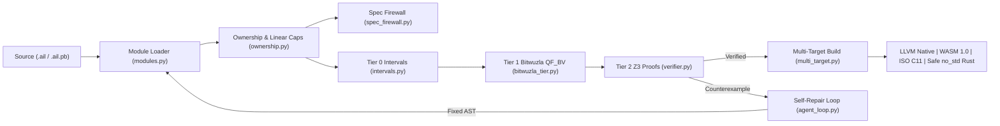

# AIL (`ailang` v1.0) — Formally Verified Multi-Target Language & Agent Toolchain

[](LICENSE)
[](pyproject.toml)
[](ARCHITECTURE.md)

**AIL (`ailang`)** is an AI-native programming language, stratified formal verifier, autonomous Protobuf self-repair harness, and bit-exact multi-target compiler designed from first principles around **AI agent economics**:

- **Zero-Loss 64-Bit Protocol Buffers (`proto/ail_agent.proto`)**: Lossless `uint64` / `int64` counterexamples, repair traces, and binary `ModuleProto` ASTs (`.ail.pb`) avoiding JSON IEEE-754 $2^{53}$ precision loss.
- **Millisecond Stratified Verification**: Tier 0 forward Interval Abstract Interpretation + Tier 1 witness-sliced 64-bit `QF_BV` in **Bitwuzla** + Tier 2 arithmetic, inductive `fold`, zero-copy `bytes`, and sharded `atomic_protocol` proofs in **Z3**.
- **Pre-Codegen Spec Firewall (`SpecMut` & `Clover`)**: Rejects vacuous preconditions (`E_SPEC_VACUOUS`), kills weak postconditions via specification mutation testing (`E_SPEC_MUTANT_SURVIVED`), and disambiguates candidate formalizations (`ail diff-specs`).
- **Four Bit-Exact Compilation Targets**:
  1. **Native Silicon (`llvm`)**: `-O3` LLVM IR (`nuw`/`nsw`/`ptr noalias`), NEON SIMD vectorization, ARMv8.1 `casal` atomics, `.dylib`/`.so`/binary, C `.h`, and Python `ctypes` bindings.
  2. **WebAssembly 1.0 (`wasm`)**: Pure-Python binary `.wasm` encoder (zero `wasm-ld` dependency), `.wat`, ESM `.mjs` `BigInt` wrapper, and TypeScript `.d.ts`.
  3. **Strict ISO C11 (`c`)**: Warning-free `.c`/`.h` (`clang -std=c11 -O3 -Wall -Wextra -Werror`) and `zig cc -target wasm32-freestanding` compatibility.
  4. **Safe `#![no_std]` Rust (`rust`)**: Standalone Cargo crate marked `#![no_std]` and `#![forbid(unsafe_code)]`, compiling cleanly under `rustc --edition 2021 -D warnings` to `.rlib`.
- **Zero-Copy `bytes`, Imports & Verified Stdlib**: Length-indexed `(bytes len)` buffers with Z3-proven big-endian readers (`byte_at`, `read_u16_be`, `read_u32_be`, `read_u64_be`, `bytes_eq4`), `(import ...)` resolution with cycle detection (`E_IMPORT_CYCLE`), `(const ...)` folding, and four built-in stdlib modules (`stdlib/math`, `stdlib/finance`, `stdlib/bits`, `stdlib/parse`).
- **Interactive Web Studio & MCP Integration**: Built-in `ail studio` playground + WASM `BigInt` sandbox (`web/`) and stdio JSON-RPC 2.0 `ail mcp` server + Antigravity plugin (`integrations/antigravity-plugin/`).

See [ARCHITECTURE.md](ARCHITECTURE.md) for the complete technical specification and [CONTRIBUTING.md](CONTRIBUTING.md) for contributor guidelines.

---

## Compilation & Verification Pipeline



---

## Quickstart

### Prerequisites & Installation

- **Python >= 3.11** and **`uv`**
- **Clang** (`clang`) for native LLVM linking & C11 builds
- **Rust** (`rustc` 2021 edition) for `.rlib` verification
- **Node.js** (`node`) for WebAssembly validation & `.mjs` execution
- **Protocol Buffers** (`protoc`, optional; required only if regenerating `proto/ail_agent.proto`)

```bash
git clone https://github.com/tachyon-ops/ailang.git
cd ailang
uv sync --extra dev
```

### Core CLI Commands

```bash
# 1. Verify types, linear capabilities, dependent structs/enums, and Z3 + Bitwuzla proofs
uv run ail check examples/sum_type_settlement.ail
uv run ail check examples/wire_frame_parser.ail

# 2. Audit specifications for vacuity and mutant survival (SpecMut)
uv run ail audit-spec examples/defi_waterfall_v1.ail

# 3. Run closed-loop autonomous repair on a multi-bug draft
uv run ail repair examples/broken_agent_draft.ail -o build/repair \
  --write-fixed build/fixed.ail --write-ast build/fixed.ail.pb

# 4. Compile verified module to ALL 4 targets (Native LLVM, WASM, C11, Safe Rust)
uv run ail build --target all --require-tight-specs examples/wire_frame_parser.ail -o build/wire_all

# 5. Inspect built-in verified stdlib modules
uv run ail stdlib

# 6. Launch AIL Web Studio (http://127.0.0.1:8765)
uv run ail studio

# 7. Run the full test suite
uv run pytest -v
```

---

## Language Highlights (v1.0)

### 1. Zero-Copy Binary Frame Parsing (`examples/wire_frame_parser.ail`)

Every `(bytes n)` read proves `0 <= idx` and `idx + width <= n` at compile time (`E_OUT_OF_BOUNDS` otherwise) — eliminating buffer over-reads across LLVM, WASM, C11, and `#![no_std]` Rust:

```lisp
(import "stdlib/parse")

(const AIL_HDR_BYTES u64 8)
(const AIL_FRAME_V1 u64 1)
(const AIL_MIN_VALID_FRAME u64 12)

(enum FrameResult
  (Valid (version u64[1..255]) (flags u64[0..255]) (payload_len u64[0..65535]) (seq u64[0..4294967295]))
  (BadMagic)
  (UnsupportedVersion (found u64[0..255]))
  (Truncated (actual u64[0..MAX]) (needed u64[1..MAX])))

(fn parse_frame ((n u64[0..MAX]) (buf (bytes n)))
  FrameResult
  (if (< n AIL_HDR_BYTES)
    (variant FrameResult Truncated n AIL_HDR_BYTES)
    (if (== (call has_ail_magic n buf) 0)
      (variant FrameResult BadMagic)
      (let ((ver (call frame_version_byte n buf)))
        (if (!= ver AIL_FRAME_V1)
          (variant FrameResult UnsupportedVersion ver)
          (let ((flags (byte_at buf 5))
                (plen (call frame_payload_len_u16 n buf))
                (needed (+ AIL_HDR_BYTES plen)))
            (if (< n needed)
              (variant FrameResult Truncated n needed)
              (if (< plen 4)
                (variant FrameResult Truncated n AIL_MIN_VALID_FRAME)
                (let ((seq (read_u32_be buf 8)))
                  (variant FrameResult Valid ver flags plen seq))))))))))
```

### 2. Dependent Refinements, Linear Capabilities & Lock-Free Atomics

- **Dependent `struct`s** (`examples/signed_struct_quote.ail`): `(struct Quote ((bid u64[0..1000000000]) (ask u64[bid..1000000000]) (pnl_adj i64[-50000..50000])))` proves `ask >= bid` statically without runtime branches.
- **Exhaustive Sum Types** (`examples/sum_type_settlement.ail`): `(enum ...)` + `(match ...)` enforces arm completeness (`E_NON_EXHAUSTIVE_MATCH`), no duplicates (`E_DUPLICATE_MATCH_ARM`), and identical linear capability consumption across all branches.
- **Linear Capabilities** (`examples/capability_sandbox_cli.ail`): Single-use `cap.io`, `cap.fs`, and `cap.net` (loopback `127.0.0.1` UDP with Z3-verified unprivileged ports `[1024..65535]`) erased to 0 bits at runtime.
- **Lock-Free CAS Conservation** (`examples/lockfree_vault.ail`): `(atomic_protocol ...)` + `(atomic_cas ...)` proves `vault + disbursed == total` across arbitrary interleavings, lowering to ARMv8.1 `casal` / C11 `<stdatomic.h>` / Rust `AtomicU64`.

---

## Standard Library (`src/ailang/stdlib/`)

| Module | Import | Verified Primitives |
| :--- | :--- | :--- |
| **`stdlib/math`** | `(import "stdlib/math")` | `midpoint_u64`, `sat_add_u64`, `sat_sub_u64`, `clamp_u64`, `clamp_i64`, `abs_diff_u64`, `div_ceil_u64` |
| **`stdlib/finance`** | `(import "stdlib/finance")` | `Quote2Way` struct, `mul_bps_floor`, `net_after_bps_fee`, `maker_rebate_capped`, `quote_spread_bps` |
| **`stdlib/bits`** | `(import "stdlib/bits")` | `low_byte`, `pack_u32_pair`, `unpack_hi32`, `unpack_lo32`, `mask_bits_u64` |
| **`stdlib/parse`** | `(import "stdlib/parse")` | `has_ail_magic` (`"AIL1"`), `frame_version_byte`, `frame_payload_len_u16` |

---

## Multi-Target Compilation Backends

Compile any verified `.ail` or `.ail.pb` module with `uv run ail build --target <target> <file>`:

| `--target` | Backend Module | Output Artifacts | Guarantees & Tooling |
| :--- | :--- | :--- | :--- |
| `native` *(default)* | `codegen_llvm.py` | `.ll`, `.s`, `.dylib`/`.so` (or bin), `.h`, `_bindings.py` | `nuw`/`nsw`, `ptr noalias`, NEON SIMD, ARMv8.1 `casal`, `ctypes` FFI |
| `wasm` | `codegen_wasm.py` | `.wasm`, `.wat`, `.mjs`, `.d.ts` | Pure-Python W3C WebAssembly 1.0 encoder, JS `BigInt` wrapper, linear memory marshaling |
| `c` | `codegen_c.py` | `.c`, `.h`, `.dylib`/`.so` | Strict ISO C11 (`clang -std=c11 -O3 -Wall -Wextra -Werror`) & `zig cc` `wasm32-freestanding` ready |
| `rust` | `codegen_rust.py` | `Cargo.toml`, `src/lib.rs`, `.rlib` | `#![no_std]` + `#![forbid(unsafe_code)]`, `AilHostCaps` trait, `rustc --edition 2021 -D warnings` |
| `all` | `multi_target.py` | `native/`, `wasm/`, `c/`, `rust/` subdirectories | Emits all 4 verified targets with collision-free directories |

---

## AIL Web Studio & MCP / Antigravity Plugin

### AIL Web Studio (`ail studio`)

Launch the local playground bound to `127.0.0.1:8765`:

```bash
uv run ail studio --host 127.0.0.1 --port 8765
```

- **6 Curated Presets**: Signed Quote, Sum Type Settlement, DeFi Fee Waterfall, Wire Frame Parser, SIMD Halving, and Broken Agent Draft.
- **Live Verification, Multi-Target Inspection & Self-Repair**: Inspect Tier 0/1/2 proof telemetry, `SpecMut` mutant kill rates, Protobuf TextFormat diagnostics, generated LLVM IR / WAT / C11 / Rust code, and step-by-step `ail repair` timelines.
- **In-Browser WebAssembly `BigInt` Sandbox**: Execute compiled `.wasm` kernels directly in browser (works live via `/api/compile` and `/api/repair`, or statically from precompiled `web/demos.json`). Regenerate the static bundle via:
  ```bash
  uv run ail studio --regenerate-demos
  ```

### MCP Server (`ail mcp`) & Antigravity Plugin (`integrations/antigravity-plugin/`)

Run the newline-delimited JSON-RPC 2.0 stdio MCP server (`ailang-mcp`, protocol `2024-11-05`):

```bash
uv run ail mcp
```

Exposed MCP tools:
1. `ail_check_and_prove` — Parse (with imports/constants), typecheck, and prove in Bitwuzla + Z3.
2. `ail_audit_spec` — Run `SpecMut` tightness audits and optional `Clover` `spec_a` vs `spec_b` equivalence diffs.
3. `ail_repair_code` — Execute closed-loop AST self-repair (`RepairSession`).
4. `ail_compile_target` — Compile verified `.ail` source/path to `native`, `wasm`, `c`, `rust`, or `all`.
5. `ail_stdlib_catalog` — Inspect built-in `src/ailang/stdlib/*.ail` modules and signatures.

The matching Antigravity plugin bundle lives in [integrations/antigravity-plugin/](integrations/antigravity-plugin/) (`plugin.json`, `mcp_config.json`, `assets/logo.svg`, `skills/ailang/SKILL.md`, `agents/ail-kernel-synthesizer.md`, `rules/AGENTS.md`). To install it locally for Antigravity from any workspace, copy the bundle to `~/.gemini/config/plugins/ailang/` and point `mcp_config.json` at your cloned repository path:

```bash
cp -R integrations/antigravity-plugin ~/.gemini/config/plugins/ailang
```

Then update `~/.gemini/config/plugins/ailang/mcp_config.json` with `"--directory", "/abs/path/to/ailang"`:

```json
{
  "mcpServers": {
    "ailang-mcp": {
      "command": "uv",
      "args": ["--directory", "/abs/path/to/ailang", "run", "ail", "mcp"]
    }
  }
}
```

---

## Empirical Benchmarks (Apple Silicon)

### 1. AIL vs. Rust / C / Python ([benchmarks/results/human_vs_ail.md](benchmarks/results/human_vs_ail.md))

- **Compile + Verify Wall Time**: AIL (`check` + `audit-spec` + LLVM `-O3` `.dylib`): **414.03 ms** | Rust (`rustc -C opt-level=3`): **433.92 ms** | C (`clang -O3 -shared`): **123.78 ms**
- **5-Kernel Token Density (`o200k_base`) & Native Latency (`ns/op`)**:
  - Total tokens across 5 kernels: **466** (AIL) vs **498** (Rust) vs **420** (C) vs **288** (Python) — with AIL beating Rust cleanly on algebraic/dependent kernels `quote_net_mid` (**91 vs 117**) and `settle_outcome_dispatch` (**90 vs 136**).
  - Native Apple Silicon throughput: **0.92–181.58 ns/op** (matching/outperforming Rust **1.82–182.98 ns/op** and C **1.38–181.35 ns/op**, vs Python **121.78–55866.46 ns/op**).
- **5-Bug Static Compiler Firewall (Zero Execution)**: AIL caught **5/5** subtle bugs (`E_U64_OVERFLOW`, `E_I64_OVERFLOW`, `E_SPEC_MUTANT_SURVIVED`, `E_STRUCT_INVARIANT_FAILED`, `E_NON_EXHAUSTIVE_MATCH`), while `rustc -O3`, `clang -Wall -Wextra -Werror`, and `py_compile` caught **0/5**.

### 2. Blind Subagent Spec-to-Silicon Evaluation ([benchmarks/results/live_llm_spec_to_silicon.md](benchmarks/results/live_llm_spec_to_silicon.md))

- **Turn-1 Verified Pass Rate**: **6/6 (100.0%)** across 6 zero-tool blind `blind_ail_coder` subagents (`clamped_bps_rebate`, `signed_sensor_step`, `dependent_window_span`, `enum_ticket_payout`, `folded_energy_sum`, `sandboxed_beacon`).
- **Average Generated Tokens (`o200k_base`)**: **123.0** tokens in **2455.5 ms** total verification + compilation + execution wall time.

Re-run benchmarks anytime:

```bash
uv run ail bench-langs -o build/bench_langs --markdown-out benchmarks/results/human_vs_ail.md
```

---

## Full CLI Reference

| Command | Purpose |
| :--- | :--- |
| `ail check <input>` | Resolve imports/constants, check ownership/linear capabilities, prove in Tier 0/1/2 |
| `ail audit-spec <input>` | Run non-vacuity and `SpecMut` specification mutation audit |
| `ail diff-specs <a> <b>` | Extract distinguishing witnesses between two candidate specs (`Clover`) |
| `ail build <input> [--target native\|wasm\|c\|rust\|all]` | Verify (optionally `--require-tight-specs`) and emit target artifacts |
| `ail run <input>` | Verify, compile, and execute a capability-gated `(main ...)` binary |
| `ail encode-ast <input> -o <out.ail.pb>` | Serialize `.ail` source to binary `ModuleProto` |
| `ail repair <input>` | Run closed-loop Protobuf verification & AST repair (`deterministic` or `gemini`) |
| `ail studio [--host 127.0.0.1] [--port 8765] [--regenerate-demos]` | Serve AIL Web Studio or regenerate `web/demos.json` |
| `ail mcp` | Run stdio JSON-RPC 2.0 MCP server (`ailang-mcp`) |
| `ail stdlib [--module <name>]` | Display built-in verified stdlib modules and signatures |
| `ail bench-langs` / `ail bench-llm` | Run cross-language silicon and blind LLM spec-to-silicon benchmarks |

Global flags: `--format human|prototext|proto` and `--proto-out <path.pb>`.

---

## License

Licensed under the [MIT License](LICENSE) — Copyright (c) 2026 tachyon-ops.
